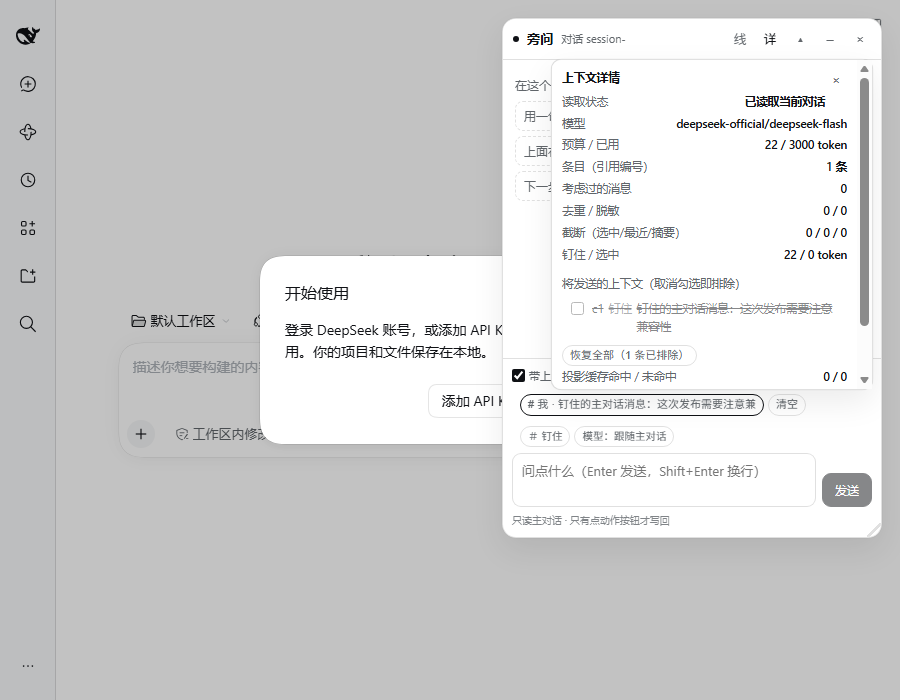
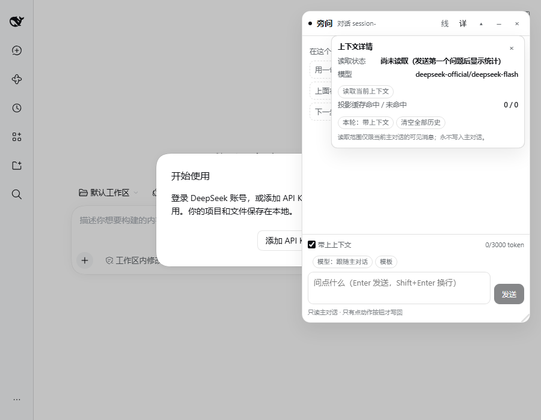

# Side Ask · 旁问

> A floating **light conversation** beside your current DeepSeek Harness chat: ask with read-only context, get cited answers in its own thread, and write back only when you click — never polluting the main conversation.

[](https://github.com/sleeping112/dsh-sideask/actions/workflows/ci.yml)
[](LICENSE)
[](package.json)
[](package.json)

English ｜ [中文](README.zh.md) · [Design](docs/design.md) · [Changelog](CHANGELOG.md)



## Why

You are deep in a long conversation and want to ask a side question — *"why is this written that way?"*, *"explain that error again"*, *"what else can this API do?"*. Asking inline derails the thread and pollutes the context; opening another window means pasting the background again.

Side Ask docks a small window next to the chat. It reads only what you can already see, answers in its **own thread**, and touches the main conversation only through the write-back buttons you press.

## Features

- **Floating window** — drag, snap to four corners, resize, minimize/collapse, remembers position and size. The closed-state bubble is draggable too (right-click re-docks it). Hotkey `Alt+Shift+A` (plugin-owned `keydown`, no host shortcut registration).
- **Own thread, own history** — new / switch / delete threads, per-thread drafts, fork a thread from an answer, regenerate the last answer. History is stored by the plugin and can be cleared at any time.
- **Read-only context** — the visible messages of the current conversation (recent N plus user selection), a background summary of older messages, token budget with a visible used/budget counter, de-duplication, two-layer secret redaction, incremental projection cache. The details panel lists every item that will be sent and lets you exclude individual items before sending.
- **Selection entry** — select text anywhere in the main chat and click the floating 「旁问」 button next to it.
- **Cited answers** — responses cite `c1..cN`; clicking a citation scrolls to and highlights the source message in the main conversation (falls back to showing the excerpt when the message cannot be located).
- **Model picker** — follow the main conversation's model, or choose an explicit provider/model from the host's catalog for side questions only.
- **Templates** — quick prompts (explain / risks / tests / clearer / summary / next steps / contradiction check) that are inserted into the draft, never sent automatically.
- **Explicit write-back** — copy, quote block, quote with note, insert as draft, or hand the conclusion to the main conversation as a task. Nothing is sent automatically; “insert as draft” asks before replacing an existing draft.
- **Privacy switches** — turn context reading off, disable history persistence, clear all history.

## Install

Requires DeepSeek Harness `0.2.0-rc.1 … 0.3.0-0` (verified on `0.2.2-rc.1`).

### From GitHub (recommended)

```sh
dsh plugin --profile web add github:sleeping112/dsh-sideask
```

Replace `web` with the profile you actually use, restart dsh, and the 「旁问」 bubble appears in the top-right corner. The repository ships a `dsh.bundle` manifest with a `cordis.patch.yml`, which is what makes it installable this way; the `prepare` script builds the host and browser halves during install.

Prebuilt tarballs are attached to [Releases](https://github.com/sleeping112/dsh-sideask/releases) (asset name `dsh-sideask.tgz`) for storefronts and for profiles that prefer not to build from source. The stable URL is `https://github.com/sleeping112/dsh-sideask/releases/latest/download/dsh-sideask.tgz`.

### From source (development)

```sh
git clone https://github.com/sleeping112/dsh-sideask.git
cd dsh-sideask
pnpm install            # `prepare` builds automatically
pnpm run build          # explicit build: host (tsc) + browser bundle (esbuild)
dsh plugin --profile web add link:$PWD
```

On Windows use `link:E:/path/to/dsh-sideask` for the last command, and see [docs/quickstart.md](docs/quickstart.md) for the isolated test recipe. After changing the host half, restart dsh; after changing the browser half, rebuild and refresh the page (or use `pnpm run dev` to rebuild on change).

## Usage

| Action | How |
|---|---|
| Open / close | `Alt+Shift+A`, the floating bubble, or the header buttons |
| Ask a side question | Type, `Enter` sends, `Shift+Enter` inserts a newline |
| Ask about a selection | Select text in the main chat → click 「旁问」 next to it |
| Carry main-chat context | The “带上上下文” toggle (default on); the counter shows `used/budget token` |
| Inspect or edit context | 「详」 → see the item list, uncheck items to exclude them |
| See what was cited | Click a `cN` chip (jumps to the source) or a citation chip under the answer |
| Pick a model | 「模型」 → follow the main conversation, or choose a provider/model for side questions |
| Use a template | 「模板」, or type `/` in an empty draft |
| Stop / retry / regenerate | Stop while streaming; retry the last failed turn; regenerate the last answer |
| Fork a thread | 「分叉」 under an answer |
| Write back | Copy / quote block / quote with note / insert as draft / hand off to the main conversation |
| Manage threads | 「线」 → new, switch, delete |
| Clear | Header menu clears the current thread; details panel clear all history |



## What it can read, and what it can write

| Layer | Behaviour |
|---|---|
| Host half | Imports no session/agent write API. One `ctx.llm.stream(...)` per question; no dsh session is created and no session log is written. |
| Model input | Request-only user input; no durable message is produced. |
| Storage | Side threads live in `$DSH_HOME/storages/sideask/threads.json`; UI state in browser `localStorage`. |
| Browser half | Reads `eventSource.getSnapshot()` snapshots; never mutates conversation state. |
| Write-back | Only the explicit buttons above, through the public composer API (`insertQuote` / `setDraft` / clipboard), with fallbacks. |
| Network | The plugin has no network access of its own. The only outbound traffic is the host model service, using your existing dsh account/model configuration. |
| Tools / files | None. The plugin does not run tools, does not read files, and does not access other sessions. |

Secret redaction (emails, phone numbers, IPs, API keys, JWTs, bearer tokens, PEM blocks, home paths, etc.) runs in the browser and is re-validated by the host before a request leaves; it is best-effort, not a guarantee.

## Configuration

The plugin exposes a schemastery `Config`; all fields are volatile (changes apply without a restart). The same values can be set in a profile `cordis.patch.yml` (see [examples/profile-patch.yml](examples/profile-patch.yml)).

| Key | Default | Meaning |
|---|---|---|
| `enabled` | `true` | Enable the host half |
| `readContext` | `true` | Privacy master switch: off ⇒ never reads the main conversation |
| `redactSensitive` | `true` | Secret redaction (browser + host, two layers) |
| `persistHistory` | `true` | Persist side-thread history |
| `recentMessageLimit` | `12` | Messages in the recent window |
| `contextBudgetTokens` | `3000` | Hard context token budget |
| `autoSummary` | `true` | Background summary of messages outside the window |
| `requireCitations` | `true` | Ask the model to cite context items |
| `answerMaxTokens` | `1200` | Answer length cap |
| `temperature` | `0.4` | Sampling temperature |
| `historyTurns` | `8` | Side-thread turns embedded in the prompt |
| `defaultCorner` | `top-right` | Default dock corner for the bubble and window |
| `pillOffset` | `40` | Vertical offset of the bubble from the top edge (px) |
| `hotkey` | `Alt+Shift+A` | Toggle hotkey |
| `provider` / `model` | `''` | Empty ⇒ host default model |
| `customRedactionPatterns` | `[]` | Extra redaction regexes |
| `maxThreads` | `30` | Stored threads (oldest dropped) |
| `maxMessagesPerThread` | `200` | Messages per thread (oldest dropped) |
| `requestTimeoutMs` | `120000` | Per-question timeout |

## Limits and resources

| Structure | Bound |
|---|---|
| Context token budget | 3000 default, hard cap 64000 (clamped in config) |
| Single context item | 35% of the budget |
| Threads / messages per thread | 30 / 200 (configurable), oldest dropped |
| Projection cache | 512 entries |
| Summary cache | 3 sessions × 8 entries × 4000 chars, persisted in `localStorage` |
| Drafts | 40 drafts × 8000 chars |
| SSE buffer | only the unfinished frame |

Measured: 200 simulated `ask` turns leave the V8 heap flat (no growth after warm-up); a real dsh instance with the plugin loaded sits at the Electron baseline. Details and evidence are in [docs/verification.md](docs/verification.md).

## Development

```sh
pnpm install                # installs dependencies and runs `prepare` (build)
pnpm run typecheck          # tsc for host and browser halves
node scripts/build.mjs      # host (tsc) + browser bundle (esbuild) + bundle-shape checks
node scripts/check.mjs      # manifest / export / no-dangerous-HTML self checks
node scripts/preflight.mjs  # delivery gate: manifest, built artifacts, package contents, screenshots, metadata
node --test                 # 241 unit and integration tests
node scripts/memory-check.mjs  # 200-turn heap-growth and thread-trim bounds
```

Layout: `src/shared` (pure, cross-platform logic) · `src/host` (Node ESM plugin) · `src/client` (browser bundle, Shadow DOM). The browser bundle is built as a single `window.__ModuleLoader__.load({ id: 'dsh-sideask', factory })` registration; the build enforces that contract, and tests execute the real bundle under a fake Module Loader.

## Documentation

- [Design document](docs/design.md) — alternatives, architecture, state machines, context budget, contracts, risks
- [UI wireframes](docs/ui-wireframe.md) · [Verification evidence](docs/verification.md)
- [Quickstart / troubleshooting](docs/quickstart.md)
- Research notes: [host API](docs/research/host-api.md) · [client API](docs/research/client-api.md) · [plugin loading patterns](docs/research/patterns.md)
- [Publishing / listing checklist](PUBLISHING.md) · [Contributing](CONTRIBUTING.md) · [Security](SECURITY.md)

## Compatibility

- DeepSeek Harness `0.2.0-rc.1 … 0.3.0-0` (manifest `dsh.compatibility`), verified on `0.2.2-rc.1`.
- Host dependency `@deepseek-ai/schemastery` `~3.19.0` is a peer dependency provided by the harness.
- Node ≥ 20 is required to build from source; installing a prebuilt release does not need Node.

## License

MIT — see [LICENSE](LICENSE). Not affiliated with DeepSeek.
