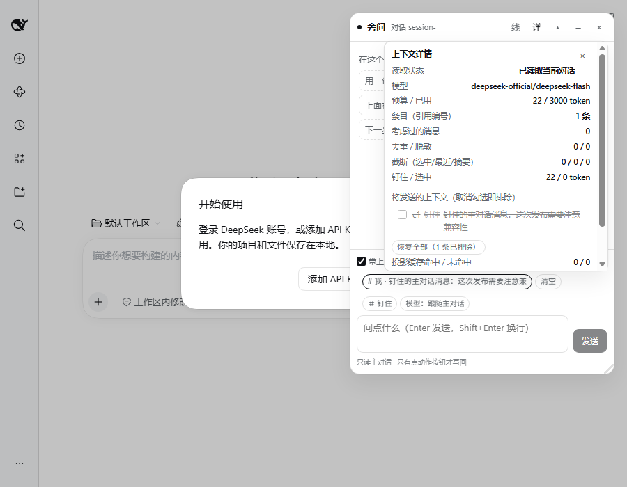
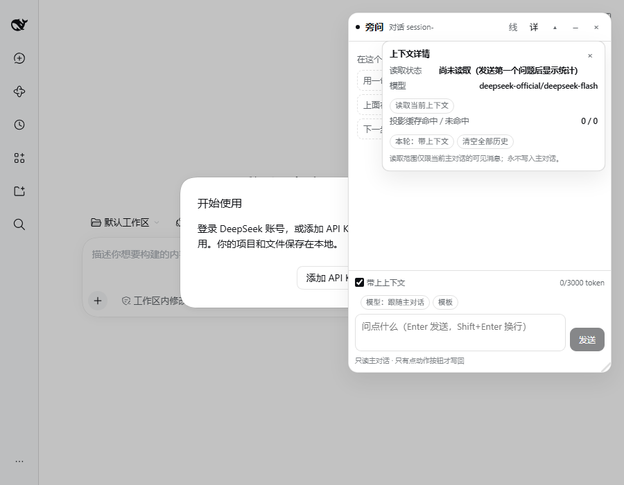

# Side Ask · 旁问

> 在 DeepSeek Harness 的当前对话旁，开一个**悬浮的轻对话**：只读当前上下文提问，回答带引用、在独立线程里进行，只有你点击写回按钮时才会碰到主对话——绝不污染主线程。

[](https://github.com/sleeping112/dsh-sideask/actions/workflows/ci.yml)
[](LICENSE)
[](package.json)
[](package.json)

中文 ｜ [English](README.md) · [设计文档](docs/design.md) · [更新日志](CHANGELOG.md)



## 为什么做它

你在一个很长的对话里想插一句题外话——「这段为什么这么写？」「刚才那个报错再解释一遍」「这个 API 还有什么用法？」。直接问会打断主线、污染上下文；另开窗口又要重新贴一遍背景。

旁问把一个小窗停在对话旁边：只读你本来就能看到的内容，在**自己的线程**里回答，并且只通过你按下的写回按钮才接触主对话。

## 功能

- **悬浮窗**——拖拽、四角吸附、缩放、最小化/折叠，记忆位置与尺寸；关闭态的小球也可拖动（右键复位到停靠角）；快捷键 `Alt+Shift+A`（插件自己监听 `keydown`，不注册宿主快捷键）。
- **独立线程与历史**——新建/切换/删除线程、按线程保存草稿、从某条回答分叉、重新生成最后一条回答；历史由插件自己保存，可随时清空。
- **只读上下文**——当前会话的可见消息（最近 N 条 + 用户选中文本）、窗口外消息的后台摘要、可见的 token 预算计数、去重、双层敏感信息脱敏、增量投影缓存。详情面板逐条列出将要发送的内容，并可在发送前单独排除。
- **划词入口**——在主对话中选中文字后，点选区旁浮出的「旁问」按钮。
- **带引用的回答**——回答标注 `c1..cN`；点击引用会滚动到并高亮主对话中的原文（定位不到时回退显示摘录）。
- **模型选择**——默认跟随主对话，也可以只为旁问指定 provider/model（来自宿主的模型目录）。
- **快捷模板**——解释 / 找风险 / 列测试 / 说清楚点 / 总结要点 / 下一步 / 矛盾检查，只写入草稿，不会自动发送。
- **显式写回**——复制、引用块、引用并附注、作为草稿插入、把结论作为任务交给主对话。绝不自动发送；「作为草稿插入」会先确认是否覆盖已有草稿。
- **隐私开关**——可关闭上下文读取、关闭历史落盘、清空全部历史。

## 安装

前置：DeepSeek Harness `0.2.0-rc.1 … 0.3.0-0`（在 `0.2.2-rc.1` 上验证）。

### 从 GitHub 安装（推荐）

```sh
dsh plugin --profile web add github:sleeping112/dsh-sideask
```

把 `web` 换成你实际使用的 profile，重启 dsh，右上角会出现「旁问」悬浮球。仓库声明了 `dsh.bundle` 清单与 `cordis.patch.yml`（这是 `dsh plugin add` 能安装它的原因）；安装时 `prepare` 脚本会构建宿主与浏览器两半。

预构建 tarball 会附在 [Releases](https://github.com/sleeping112/dsh-sideask/releases)（资产名 `dsh-sideask.tgz`），供插件市场或不想从源码构建的 profile 使用。稳定地址：`https://github.com/sleeping112/dsh-sideask/releases/latest/download/dsh-sideask.tgz`。

### 从源码安装（开发）

```sh
git clone https://github.com/sleeping112/dsh-sideask.git
cd dsh-sideask
pnpm install            # `prepare` 会自动构建
pnpm run build          # 显式构建：宿主(tsc) + 浏览器 bundle(esbuild)
dsh plugin --profile web add link:$PWD
```

Windows 下最后一条用 `link:E:/path/to/dsh-sideask`；隔离测试流程见 [docs/quickstart.md](docs/quickstart.md)。改宿主要重启 dsh；改浏览器半重新构建后刷新页面（或用 `pnpm run dev` 持续构建）。

## 使用

| 动作 | 操作 |
|---|---|
| 打开 / 收起 | `Alt+Shift+A`、悬浮球或标题栏按钮 |
| 提问 | 输入后 `Enter` 发送，`Shift+Enter` 换行 |
| 用选中文本提问 | 在主对话选中文字 → 点选区旁「旁问」 |
| 带上主对话上下文 | 「带上上下文」开关（默认开），计数显示 `已用/预算 token` |
| 查看或编辑上下文 | 「详」→ 逐条查看，取消勾选即排除该条 |
| 查看引用了什么 | 点回答里的 `cN` chip（跳转原文），或点回答下方的引用 chip |
| 选择模型 | 「模型」→ 跟随主对话，或为旁问指定 provider/model |
| 快捷模板 | 「模板」，或在空输入框里输入 `/` |
| 停止 / 重试 / 重新生成 | 流式中点「停止」；失败可重试；最后一条回答可重新生成 |
| 分叉线程 | 回答下方「分叉」 |
| 写回主对话 | 复制 / 引用块 / 引用并附注 / 作为草稿插入 / 交给主对话 |
| 管理线程 | 「线」→ 新建、切换、删除 |
| 清空 | 标题栏菜单清空当前线程；详情面板清空全部历史 |



## 能读什么、能写什么

| 层 | 行为 |
|---|---|
| 宿主半 | 不 import 任何会话/Agent 写接口。每次提问只调用一次 `ctx.llm.stream(...)`；不创建 dsh 会话、不写会话日志。 |
| 模型输入 | request-only 的 user 输入，不产生 durable message。 |
| 存储 | 旁问线程只存在 `$DSH_HOME/storages/sideask/threads.json`；UI 状态存在浏览器 `localStorage`。 |
| 浏览器半 | 只读 `eventSource.getSnapshot()` 快照，不修改会话状态。 |
| 写回 | 仅上表中的显式按钮，走主对话输入框的公开 API（`insertQuote` / `setDraft` / 剪贴板），并有回退。 |
| 网络 | 插件自身不访问网络；唯一的外发流量是宿主模型服务，复用你现有的 dsh 账号/模型配置。 |
| 工具 / 文件 | 无。不执行工具、不读文件、不访问其它会话。 |

敏感信息脱敏（邮箱、电话、IP、API Key、JWT、Bearer、PEM、家目录、用户名等）在浏览器执行，宿主在请求发出前会再校验一遍；这是尽力而为，不是保证。

## 配置

插件导出 schemastery `Config`，所有字段都是 volatile（保存即生效）。也可以写进 profile 的 `cordis.patch.yml`（示例见 [examples/profile-patch.yml](examples/profile-patch.yml)）。

| 键 | 默认 | 说明 |
|---|---|---|
| `enabled` | `true` | 是否启用宿主半 |
| `readContext` | `true` | 隐私总开关：关掉后完全不读主对话 |
| `redactSensitive` | `true` | 敏感信息脱敏（浏览器 + 宿主双层） |
| `persistHistory` | `true` | 轻对话历史是否落盘 |
| `recentMessageLimit` | `12` | 最近 N 条 |
| `contextBudgetTokens` | `3000` | 上下文 token 预算上限 |
| `autoSummary` | `true` | 窗口外消息的后台摘要 |
| `requireCitations` | `true` | 要求模型标注引用 |
| `answerMaxTokens` | `1200` | 回答长度上限 |
| `temperature` | `0.4` | 采样温度 |
| `historyTurns` | `8` | 提示词里内嵌的旁问轮数 |
| `defaultCorner` | `top-right` | 悬浮球与悬浮窗默认停靠角 |
| `pillOffset` | `40` | 悬浮球距顶部偏移（px） |
| `hotkey` | `Alt+Shift+A` | 唤起快捷键 |
| `provider` / `model` | `''` | 留空 = 用宿主默认模型 |
| `customRedactionPatterns` | `[]` | 自定义脱敏正则 |
| `maxThreads` | `30` | 保留线程数（超出丢最旧） |
| `maxMessagesPerThread` | `200` | 单线程消息数（超出丢最旧） |
| `requestTimeoutMs` | `120000` | 单次提问超时 |

## 资源与内存边界

| 结构 | 上限 |
|---|---|
| 上下文 token 预算 | 默认 3000，硬顶 64000（配置钳制） |
| 单条上下文 | 预算的 35% |
| 线程 / 单线程消息 | 30 / 200（可配），超出丢最旧 |
| 投影缓存 | 512 条 |
| 摘要缓存 | 3 会话 × 8 条 × 4000 字，持久化在 `localStorage` |
| 草稿 | 40 条 × 8000 字 |
| SSE 缓冲 | 只保留未完成的半帧 |

实测：200 轮模拟 `ask` 后 V8 堆稳定、无增长；加载插件的真实 dsh 实例处于 Electron 基线量级。证据见 [docs/verification.md](docs/verification.md)。

## 开发

```sh
pnpm install                # 安装依赖并执行 `prepare`（构建）
pnpm run typecheck          # 宿主与浏览器半的 tsc
node scripts/build.mjs      # 宿主(tsc) + 浏览器 bundle(esbuild) + bundle 形状检查
node scripts/check.mjs      # 清单 / 导出 / 危险 HTML 自检
node scripts/preflight.mjs  # 交付闸门：manifest、构建产物、包内容、截图、元数据
node --test                 # 241 项单元/集成测试
node scripts/memory-check.mjs  # 200 轮堆增长与线程裁剪上界
```

结构：`src/shared`（双端纯逻辑，可单测）· `src/host`（Node ESM 插件）· `src/client`（浏览器 bundle，Shadow DOM）。浏览器 bundle 只注册一次 `window.__ModuleLoader__.load({ id: 'dsh-sideask', factory })`，构建会强制校验，测试会在假 Module Loader 下执行真实 bundle。

## 文档

- [设计文档](docs/design.md)——方案对比、架构、状态机、上下文预算、契约、风险
- [线框与交互](docs/ui-wireframe.md) · [验证证据](docs/verification.md)
- [快速开始 / 排障](docs/quickstart.md)
- 取证笔记：[宿主 API](docs/research/host-api.md) · [客户端 API](docs/research/client-api.md) · [插件装载模式](docs/research/patterns.md)
- [上架与投稿清单](PUBLISHING.md) · [参与开发](CONTRIBUTING.md) · [安全策略](SECURITY.md)

## 兼容性

- DeepSeek Harness `0.2.0-rc.1 … 0.3.0-0`（manifest 的 `dsh.compatibility`），在 `0.2.2-rc.1` 上验证。
- 宿主依赖 `@deepseek-ai/schemastery` `~3.19.0` 以 peerDependency 声明，由宿主提供。
- 从源码构建需要 Node ≥ 20；安装预构建 release 不需要 Node。

## 许可

MIT，见 [LICENSE](LICENSE)。与 DeepSeek 官方无关。
